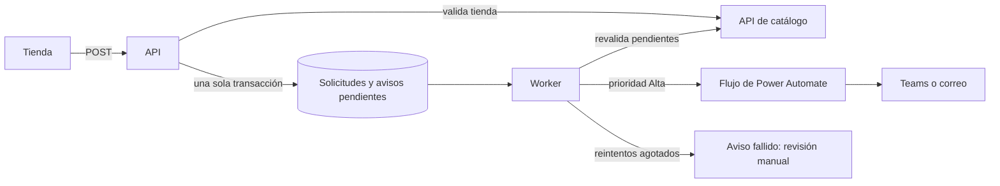

# Evolución del prototipo

Propuesta no implementada: la **API (código)** valida, controla duplicados y reintentos; **Power Automate** publica el aviso en Teams o correo.

## a) Notificaciones sin duplicados

- Al crear una solicitud de prioridad **Alta**, se guarda junto con un aviso pendiente (patrón *outbox*) en la misma transacción.
- La tabla de avisos tiene una restricción única por `solicitud_id` y canal.
- Un worker toma cada aviso, llama al flujo y lo marca como enviado.
- El flujo registra el identificador del aviso y descarta los repetidos. Si el envío ocurre pero falla la confirmación, esta segunda barrera reduce el riesgo de duplicarlo; no lo elimina por completo.

## b) Validación de tienda

| Respuesta del catálogo | Acción |
|---|---|
| La tienda existe | Guardar como validada |
| La tienda no existe | Responder 422 |
| Error 5xx, 429 o sin respuesta | Guardar como "validación pendiente" y reintentar |

Así una caída del catálogo no impide reportar novedades. Si al revalidar la tienda no existe, la solicitud se marca para revisión. Los avisos urgentes salen aunque la validación siga pendiente, indicándolo en el mensaje.

## Reintentos y fallos

- **Al registrar:** un solo intento al catálogo con timeout de 3 segundos, para no bloquear a la tienda.
- **Worker:** hasta 5 reintentos con espera creciente y variación aleatoria.
- Solo se reintentan errores temporales (red, 429 y 5xx); los errores 401 o 403 generan una alerta de configuración.
- Tras repetidos fallos del catálogo, se pausan las llamadas temporalmente (*circuit breaker*).
- Los avisos que agotan los intentos quedan como **fallidos**, con el error y la fecha, para revisarlos y reenviarlos.

## Credenciales

- En local, variables de entorno en `.env`, excluido de Git.
- En producción, un gestor de secretos (por ejemplo, AWS Secrets Manager), con mínimo privilegio y rotación.
- La URL del flujo se trata como secreto y los registros no incluyen claves ni tokens.

## Por qué esta combinación

| Opción | Ventaja | Limitación |
|---|---|---|
| Solo código | Control y pruebas | Hay que mantener las integraciones |
| Solo Power Automate | Rápido y fácil de ajustar | Menor control de duplicados, versiones y pruebas |
| **Combinación** | Reglas en código y envío sencillo | Dos componentes por monitorear; verificar licencias de los conectores |

Para crecer, SQLite se reemplazaría por PostgreSQL y el worker podría usar una cola como Amazon SQS con cola de mensajes fallidos.
